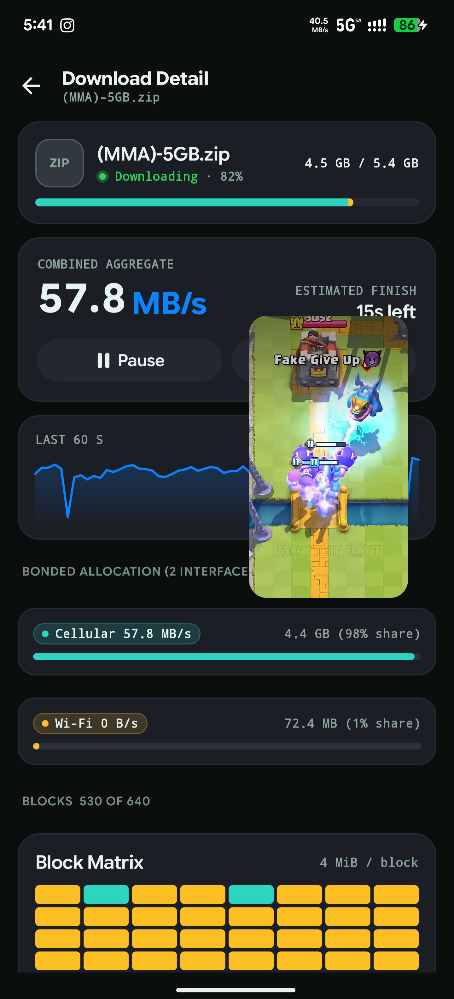
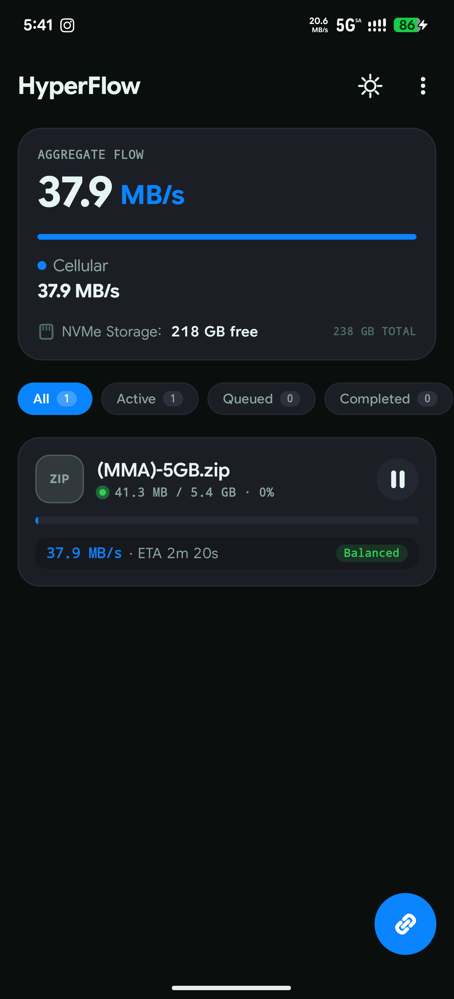
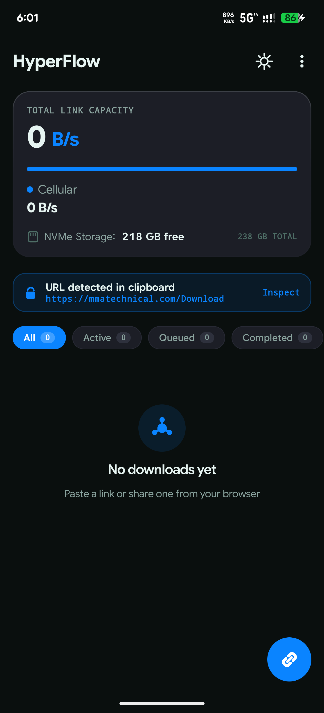

# HyperFlow ⚡

> **Multi-Interface High-Speed Download Accelerator for Android**

HyperFlow is a next-generation Android download manager that bonds multiple physical network connections (**Wi-Fi, 5G Cellular, and Ethernet**) simultaneously to achieve unprecedented download throughput.

[-3DDC84?style=for-the-badge&logo=android&logoColor=white)](https://github.com/atharva01c/HyperFlow-App/releases)

---

## 📱 Screenshots

  
  &nbsp;&nbsp;&nbsp;&nbsp;
  
  &nbsp;&nbsp;&nbsp;&nbsp;
  

---

## ✨ Key Features

* **⚡ True Multi-Rail Network Multiplexing**
  * Simultaneously bonds active physical interfaces: **Wi-Fi + 5G / 4G Cellular + USB-C / Ethernet**.
  * Bypasses traditional single-connection OS bottlenecks by routing independent TCP/HTTP streams directly through dedicated socket bindings (`Network.bindSocket`).

* **🧩 Dynamic Block Matrix & Work-Stealing**
  * Automatically splits target files into 4 MiB block ranges.
  * Faster radios continuously steal pending work from slower ones, ensuring 100% capacity utilization across all available links.

* **🔄 Zero-Loss Live Network Handover**
  * Seamlessly adapts when you walk out of Wi-Fi range or toggle networks on/off.
  * Active streams instantly shift to surviving links without stalling, failing, or re-downloading existing progress.

* **🍎 Apple-Grade Fluid UI & Craft**
  * Built with Jetpack Compose, featuring tactile spring physics, direct haptic feedback, specular glass lighting, and seamless Light/Dark mode transitions.
  * Real-time aggregate telemetry with per-network allocation visualization.

* **🛡️ Resilient & Private**
  * Robust resume capabilities utilizing HTTP 206 partial range requests.
  * Automatic clipboard link detection.
  * Files are safely published directly into your public `Downloads/HyperFlow/` folder upon completion.

---

## 📥 How to Install

1. Navigate to the **[Latest Releases](https://github.com/atharva01c/HyperFlow-App/releases)** page.
2. Under **Assets**, tap and download `HyperFlow-v0.1.0-debug.apk` (or latest release build).
3. Open the downloaded file on your Android device and allow *"Install from unknown sources"* if prompted.
4. Launch **HyperFlow** and experience combined multi-network downloading!

---

## ⚙️ Requirements

* **Android OS:** Android 10 (API Level 29) or newer.
* **Architecture:** Compatible with `arm64-v8a`, `armeabi-v7a`, `x86_64`.
* **Hardware:** Any Android device with active Wi-Fi and/or Cellular connectivity.

---

## 🛠️ Architecture Overview

HyperFlow is engineered with an isolated two-module architecture:
* **`:engine`** — A pure Kotlin concurrent download scheduler with zero Android dependencies:
  * Concurrency Controller with hedge racing and work-stealing.
  * Windowed Speed Meter and Stream Governors.
* **`:app`** — Modern Android application shell:
  * Jetpack Compose & Material 3 UI design system.
  * Low-level socket network binding with Android ConnectivityManager.
  * Background Foreground Service (`dataSync` type) with media store publication.

---

## 💬 Feedback & Bug Reports

Found an issue or have a feature suggestion? 
Feel free to open an issue on the **[HyperFlow-App Issue Tracker](https://github.com/atharva01c/HyperFlow-App/issues)**!
